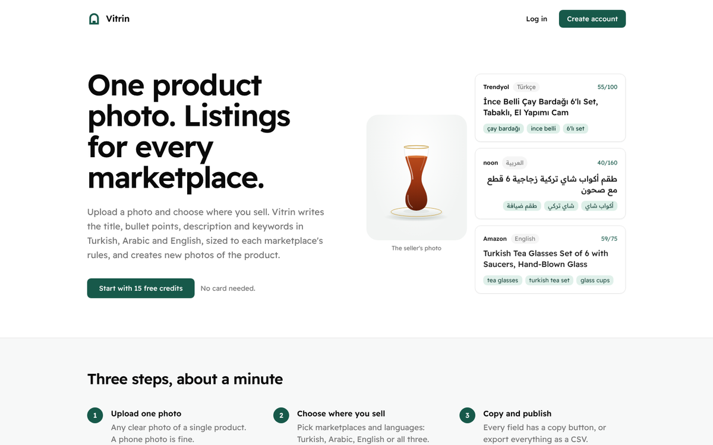
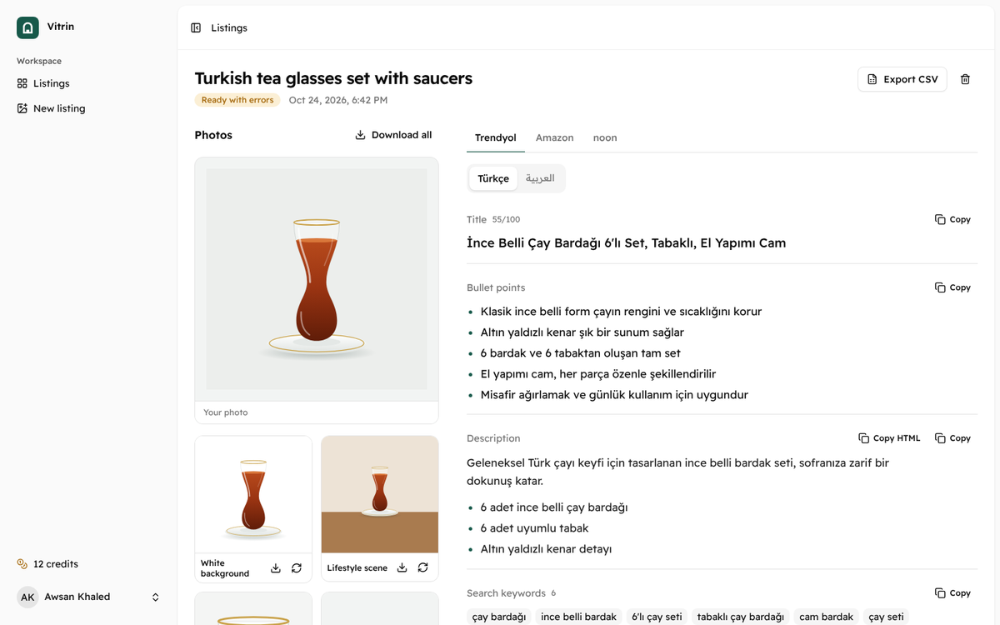
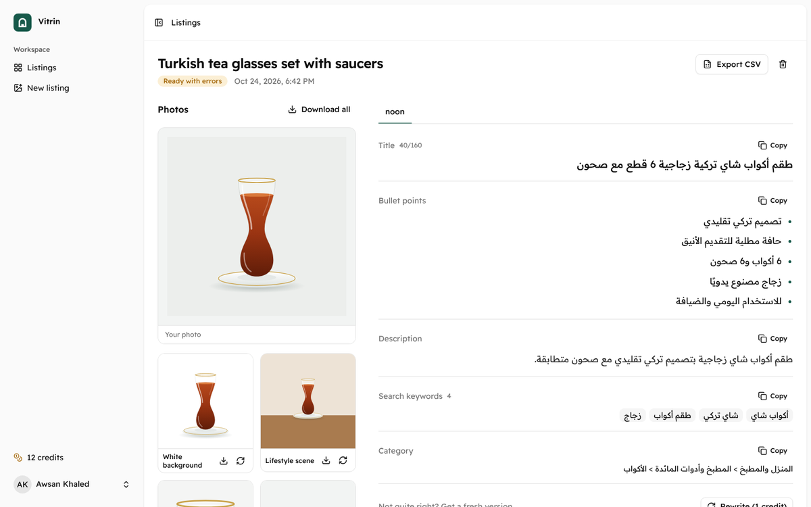
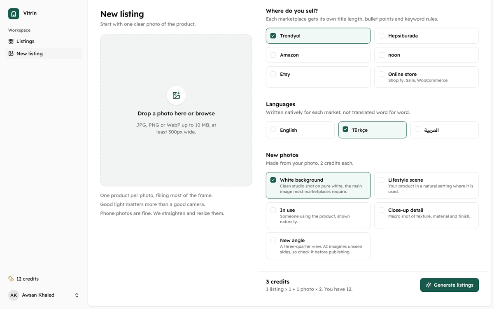
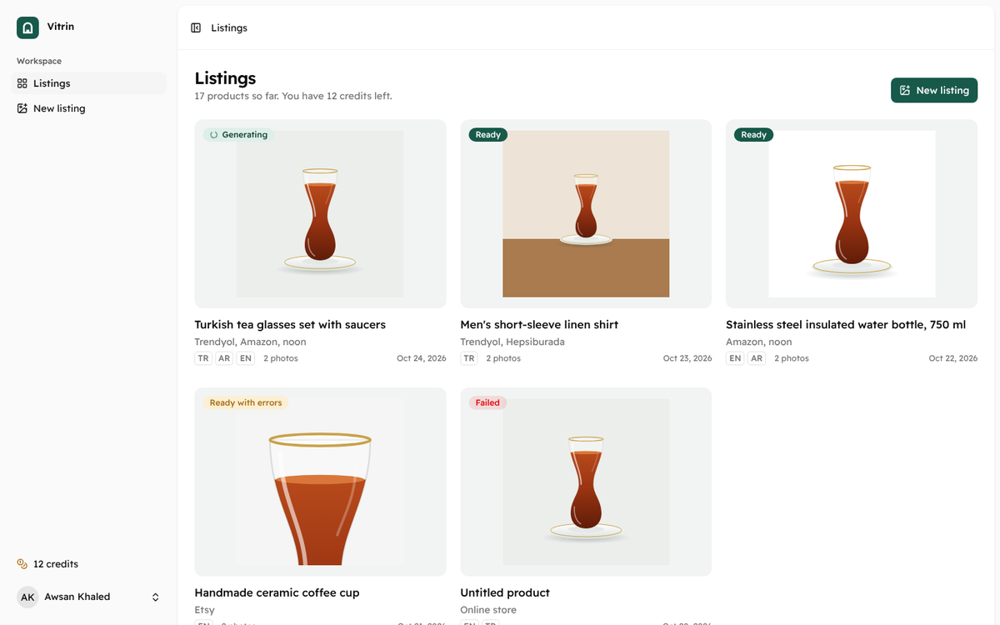

# Vitrin

Marketplace-ready product listings from one photo. A seller uploads a product photo, picks where they sell (Trendyol, Hepsiburada, Amazon, noon, Etsy or their own store) and the languages they need (Turkish, Arabic, English). Vitrin writes the title, bullet points, description, keywords and category for each marketplace, sized to its rules, and creates new photos of the product: white background, lifestyle, in use, close-up and new angle.

Built with Laravel 13, React 19 (Inertia), the Laravel AI SDK and Gemini.



| Results                                       | Arabic, right to left                                  |
| --------------------------------------------- | ------------------------------------------------------ |
|  |  |

| New listing                                           | Listings                                     |
| ----------------------------------------------------- | -------------------------------------------- |
|  |  |

## What it does

- **One photo in, many listings out.** Every marketplace and language combination is written separately, natively in each language rather than translated word for word.
- **Marketplace rules, enforced.** Amazon titles of 75 characters or fewer plus item highlights, noon titles without brand or color, Hepsiburada's title order, Trendyol's first 30 characters, Etsy's 13 tags of 20 characters. Rules are injected into the prompt and then checked in code; anything trimmed is shown to the seller as a warning.
- **Honest copy.** A first AI pass extracts only what is visible in the photo or stated by the seller. Attributes it can't confirm (exact material, capacity, compatibility) are listed as "check before publishing" and kept out of the copy.
- **New photos from the original.** Image generation uses the seller's photo as the reference so the product stays the same.
- **Copy, paste, export.** Copy buttons on every field, "Copy HTML" for marketplaces that accept HTML, CSV export (Excel-safe UTF-8 for Turkish and Arabic) and a ZIP of all photos.
- **Credits.** New accounts get free credits, and sellers buy credit packs through Paddle (see Payments). Each listing and photo costs credits. Anything that fails is refunded automatically and can be tried again from the results page, and a double click never charges twice. Full history per account.
- **Accounts.** Registration, email verification, password reset and two-factor login from the Laravel starter kit.

## How it works

```
Upload ─▶ ProductImage (fix rotation, resize, JPEG)
       ─▶ AnalyzeListing job ── ProductAnalyst agent (vision, structured output)
                                 └─ product facts + "needs confirmation" list
       ─▶ WriteListingCopy job × (marketplaces × languages)
              ListingWriter agent (text, structured output, marketplace rules)
              └─ ListingCopyNormalizer enforces limits, records warnings
       ─▶ GenerateListingPhoto job × photo styles
              Laravel AI Image with the original photo attached
```

- `app/Ai/Agents` holds the two agents, and `app/Ai/PhotoPrompt.php` the photo prompts.
- `config/vitrin.php` holds providers, credit costs and the marketplace rules, with the sources they come from.
- `app/Services/ListingGenerator.php` runs the workflow: start, try a failed listing again, regenerate one item, fail and refund.
- `app/Services/CreditLedger.php` makes every balance change, so balances and history always agree.
- Jobs run on the database queue. On shared hosting a single cron entry runs the scheduler, which starts a short-lived queue worker every minute (`routes/console.php`).

Only the analysis step sees the image. The per-marketplace writers are fast, cheap text calls, and each one can fail and be retried or refunded on its own.

## Run it locally

Requirements: PHP 8.3+, Composer 2, Node 22+.

```bash
composer install
cp .env.example .env
php artisan key:generate
touch database/database.sqlite
php artisan migrate
npm install
npm run check:fix   # once: applies the project's formatter to the new files
composer dev        # app server, queue worker, logs and Vite together
```

The first `composer install` and `npm install` create `composer.lock` and `package-lock.json`. Commit both, together with any formatting changes from `npm run check:fix`, so CI and deployments install the same versions and the lint check passes.

Open http://localhost:8000 and create an account. Locally, emails (including the verification link) are written to `storage/logs/laravel.log`.

Add your AI key to `.env`:

```dotenv
GEMINI_API_KEY=your-key   # https://aistudio.google.com/apikey
```

One Gemini key covers both text and images. Image generation may need a billing-enabled key. To use another provider supported by the Laravel AI SDK, set `VITRIN_TEXT_PROVIDER` / `VITRIN_IMAGE_PROVIDER` (for example `openai`) and that provider's key. Leave the `*_MODEL` variables empty to use the provider's default model.

## Configuration

| Variable                                       | Default                     | What it does                                             |
| ---------------------------------------------- | --------------------------- | -------------------------------------------------------- |
| `VITRIN_TEXT_PROVIDER` / `VITRIN_TEXT_MODEL`   | `gemini` / provider default | Writes the listings and analyzes the photo               |
| `VITRIN_IMAGE_PROVIDER` / `VITRIN_IMAGE_MODEL` | `gemini` / provider default | Creates the photos                                       |
| `VITRIN_IMAGE_QUALITY`                         | `medium`                    | `low`, `medium` or `high` (about 1K, 2K or 4K on Gemini) |
| `VITRIN_SIGNUP_CREDITS`                        | `15`                        | Free credits for new accounts                            |
| `VITRIN_COPY_COST` / `VITRIN_PHOTO_COST`       | `1` / `2`                   | Credits per listing and per photo                        |
| `DB_QUEUE_RETRY_AFTER`                         | `300`                       | Must stay longer than the slowest job (180 seconds)      |

Marketplace rules (title limits, bullet counts, keyword limits and prompt rules) live in `config/vitrin.php`. Marketplaces change their policies, so re-check them from time to time; the file notes where each rule came from.

To add credits by hand (support cases, promotions), use the command line:

```bash
php artisan credits:grant seller@example.com 100 --note="Goodwill credits"
```

## Payments (Paddle, paid out to Payoneer)

Sellers buy one-time credit packs. [Paddle](https://www.paddle.com) runs the checkout as **merchant of record**: it charges the card, adds and pays VAT or sales tax for each country, sends receipts and invoices, and handles fraud, refunds and chargebacks. Once a month it pays your earnings out to **Payoneer** (or a bank account).

### How it works

```
Buy (Credits page) ─▶ CreditPurchase row (pending) ─▶ Paddle checkout overlay (Paddle.js)
Paddle ─▶ POST /webhooks/paddle  transaction.completed ─▶ credits added once
                                 adjustment.* (refund, chargeback) ─▶ credits taken back
```

- Packs are in `config/vitrin.php` (Starter 100, Growth 300, Business 1000 credits). The price of each pack lives in Paddle, and the site shows Paddle's price, so they can't drift apart.
- Webhooks are accepted only with a valid `Paddle-Signature` (HMAC-SHA256 with your secret). Without `PADDLE_WEBHOOK_SECRET`, every webhook is refused and no checkout is offered.
- Credits come from the purchase row the server created, and the payment must be for that pack's exact price, so editing the checkout in the browser can't buy credits cheaply.
- Paddle retries webhooks, so each payment and each refund is applied once only (row locks plus a unique reference per Paddle event).
- Refunds and chargebacks take the credits back, never below zero. If they were already spent, a warning is logged so you can review the account.
- Card details never reach your server. Paddle.js loads only on the Credits page.
- The terms, privacy policy and refund policy are at `/terms`, `/privacy` and `/refunds` and linked from every public page. They are templates written to match how the app works; have them checked by a lawyer for your situation.

### Set up a test (sandbox) account

1. Create a sandbox account at <https://sandbox-vendors.paddle.com/signup>. Sandbox payments use test cards and no real money.
2. **Catalog > Products:** add a product such as "Vitrin credits", then add three one-time prices to it, for example $9 (Starter), $24 (Growth) and $69 (Business). Copy each price ID (`pri_...`).
3. **Developer tools > Authentication:** create a client-side token, and an API key. If Paddle offers permission choices for the key, read access to prices is all it needs.
4. **Developer tools > Notifications:** add a webhook destination with the URL `https://your-domain/webhooks/paddle` and the events `transaction.completed`, `adjustment.created` and `adjustment.updated`. Copy its secret key. Paddle can't reach `localhost`; to test webhooks on your computer, expose it with a tunnel such as `cloudflared` or `ngrok`.
5. **Checkout > Checkout configuration:** set the default payment link to `https://your-domain/settings/credits`. Paddle requires one, and the Credits page opens payment links that Paddle emails to customers.
6. Add the values to `.env`, then run `php artisan config:clear`:

    ```dotenv
    PADDLE_ENVIRONMENT=sandbox
    PADDLE_CLIENT_TOKEN=test_...
    PADDLE_API_KEY=...
    PADDLE_WEBHOOK_SECRET=pdl_ntfset_...
    PADDLE_PRICE_STARTER=pri_...
    PADDLE_PRICE_GROWTH=pri_...
    PADDLE_PRICE_BUSINESS=pri_...
    ```

7. Buy a pack on the Credits page with the test card `4242 4242 4242 4242`, any name, a future expiry date and CVC `100`. The credits appear within seconds of the webhook arriving.

### Go live

1. **Sign up** for a live account at <https://vendors.paddle.com/signup>. As a sole trader you verify your identity; company documents are only needed for a company.
2. **Fill in your business details** in the server's `.env`. They appear in the terms and policies, and Paddle's review requires your legal name in the terms:

    ```dotenv
    VITRIN_LEGAL_NAME="Your full legal name or company name"
    VITRIN_LEGAL_ADDRESS="Street, city"
    VITRIN_LEGAL_COUNTRY=Türkiye
    VITRIN_SUPPORT_EMAIL=support@your-domain
    ```

3. **Submit your domain** in Paddle under the website approval settings. Paddle checks for a product description, pricing (the `#pricing` section of the home page), the terms, refund and privacy policies in the navigation, your legal name in the terms, and HTTPS. Most domains are approved automatically; a manual review takes about 5 to 7 business days.
4. **Repeat the sandbox steps 2 to 5 in the live account.** Live and sandbox are separate, so every ID, token, key and secret is different. Put them in the server's `.env` with `PADDLE_ENVIRONMENT=production`, then run `php artisan optimize`.
5. **Connect Payoneer for payouts:** in the Paddle dashboard, open the payout settings, choose Payoneer as the payout method and connect your account. Paddle pays monthly: your balance becomes a payout on the 1st when it's over your threshold (at least $100), and is sent by the 15th. Paddle's fee is taken from each sale; Payoneer's own fees depend on your Payoneer account.
6. **Make one real purchase** with your own card and refund it from the Paddle dashboard. You'll see the credits added and then removed. Live refunds may wait for Paddle's approval first.

## Tests and checks

```bash
php artisan test      # feature tests with the AI faked: pipeline, refunds, retries, access control, exports
composer test         # the above plus Pint and PHPStan (level 7)
composer ci:check     # everything CI runs, including the frontend linter and TypeScript
```

## Deploy to Hostinger (Business web hosting)

Hostinger's shared plans run PHP but not long-running processes, so Vitrin builds everything in GitHub Actions and uploads it over SSH. The queue runs from one cron entry.

### 1. Prepare the hosting (once)

1. **PHP:** in hPanel, go to Websites, your site, Advanced, PHP Configuration and choose PHP 8.3 or newer. Make sure the `gd`, `exif`, `zip`, `intl`, `fileinfo` and `pdo_mysql` extensions are on.
2. **Database:** under Databases, Management, create a MySQL database and user. Note the database name, user and password.
3. **SSH:** under Advanced, SSH Access, enable SSH. Note the IP, port (usually `65002`) and username (like `u123456789`). Create a key pair for deployments with `ssh-keygen -t ed25519 -f hostinger_deploy` and add `hostinger_deploy.pub` there.
4. **App folder:** connect with `ssh -p 65002 u123456789@IP` and run `mkdir -p ~/domains/example.com/vitrin`.

### 2. Connect GitHub (once)

In the repository, open Settings, Secrets and variables, Actions:

- Secrets: `HOSTINGER_SSH_HOST`, `HOSTINGER_SSH_PORT`, `HOSTINGER_SSH_USER`, and `HOSTINGER_SSH_KEY` (the contents of the private `hostinger_deploy` file).
- Variable: `HOSTINGER_APP_PATH` = `domains/example.com/vitrin`.
- Optional variable `HOSTINGER_PHP`: if `php -v` over SSH shows a different version from your site's, set this to the PHP binary that matches.

From then on, every push to `main` that passes the tests is deployed by `.github/workflows/deploy.yml`. You can also run it by hand from the Actions tab.

### 3. First deploy

1. Run the deploy workflow once to upload the code.
2. On the server, create the environment file:

    ```bash
    cd ~/domains/example.com/vitrin
    cp .env.example .env
    nano .env
    ```

    Set at least the following:

    ```dotenv
    APP_ENV=production
    APP_DEBUG=false
    APP_URL=https://example.com
    SESSION_SECURE_COOKIE=true
    LOG_STACK=daily
    LOG_LEVEL=warning
    DB_CONNECTION=mysql
    DB_HOST=localhost
    DB_DATABASE=u123456789_vitrin
    DB_USERNAME=u123456789_vitrin
    DB_PASSWORD=...
    GEMINI_API_KEY=...
    MAIL_MAILER=smtp
    MAIL_SCHEME=smtps
    MAIL_HOST=smtp.hostinger.com
    MAIL_PORT=465
    MAIL_USERNAME=no-reply@example.com
    MAIL_PASSWORD=...
    MAIL_FROM_ADDRESS=no-reply@example.com
    ```

    `SESSION_SECURE_COOKIE` sends the login cookie over HTTPS only, and the two `LOG_` settings rotate the log daily (14 days are kept) without debug noise.

    Then run `php artisan key:generate` and `php artisan migrate --force`.

3. Point the domain at Laravel's `public` folder:

    ```bash
    cd ~/domains/example.com
    mv public_html public_html_old
    ln -s vitrin/public public_html
    ```

4. Add the cron job: in hPanel, go to Advanced, Cron Jobs, Custom, and run this every minute:

    ```
    cd /home/u123456789/domains/example.com/vitrin && php artisan schedule:run >> /dev/null 2>&1
    ```

5. Turn on the free SSL certificate for the domain under Security, SSL.

Photos are stored privately in `storage/app/private` and served only to their owner, so `php artisan storage:link` isn't needed.

If you outgrow shared hosting, move to a VPS, run `php artisan queue:work` under Supervisor, and remove the scheduled worker from `routes/console.php`.

## Roadmap

- The interface in Turkish and Arabic
- Bulk mode: upload an Excel sheet of products, download ready-to-import files
- Publish straight to marketplaces through their seller APIs

## License

Proprietary, all rights reserved. Choose a license before you make the repository public if you want others to reuse the code.
